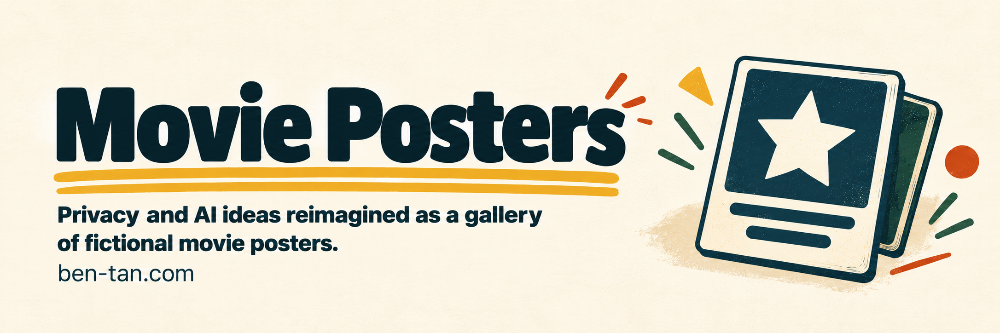

# Movie Posters

Privacy and AI ideas reimagined as a gallery of fictional movie posters.

<p>
<a href="https://ben-tan.com/guides/movie-posters/"></a>&nbsp; 
<a href="https://ko-fi.com/itsbent"><picture><source media="(prefers-reduced-motion: reduce)" srcset="docs/images/buttons/kofi-static.svg"></picture></a>&nbsp; 
</p>

[](docs/images/banner.png)

*[Open at ben-tan.com](https://ben-tan.com/guides/movie-posters/).*

## What it does

Browse 44 posters across horror, The Privacy Wizard, Privacy Wars, and The Consent Matrix. Open a poster to see the complete image and its privacy premise.

Concepts and editorial selection are by Ben Tan, with ChatGPT image-generation assistance. The collection is satire inspired by familiar film imagery, not an official film collaboration.

## Run locally

Source checks need Node.js 24 or newer and no dependency installation:

```sh
npm run check
npm run verify
```

**A full gallery build also requires shared website files and the approved image set, which are not distributed with this source checkout.** Use the [public gallery](https://ben-tan.com/guides/movie-posters/) to view the work without those inputs.

When those inputs are available:

```sh
npm run build -- --shell-root /path/to/shared-site --art-root /path/to/approved-images --include-art --out .local/gallery
npm start -- --shell-root /path/to/shared-site --art-root /path/to/approved-images --out .local/gallery --port 8894
```

`--shell-root` contains the shared page framing and resources. `--art-root` contains the runtime PNG names listed in `assets/manifest.json`. The preview serves `/guides/movie-posters/` on loopback.

## Build and check

```sh
npm run verify -- --art-root /path/to/approved-images
```

The manifest records stable poster IDs, dimensions, and hashes. Builds copy verified artwork without redrawing or recompressing it. Only generated runtime files belong in a website package.

## Limitations

The source checkout alone does not reproduce the hosted gallery. Production records, prompts, curation notes, and historical helpers are records of the collection, not required reader downloads or portable build commands.

## License and credits

The collection is [all rights reserved](LICENSE). Film references, artwork, fonts, and other third-party materials retain their respective rights. See [rights and notices](THIRD_PARTY.md). A displayed image or download control does not grant permission to redistribute or adapt the work.

---

Made by [Ben Tan](https://ben-tan.com). [Report a security issue](SECURITY.md).
